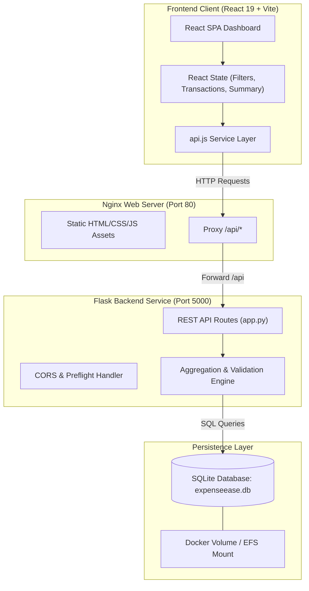
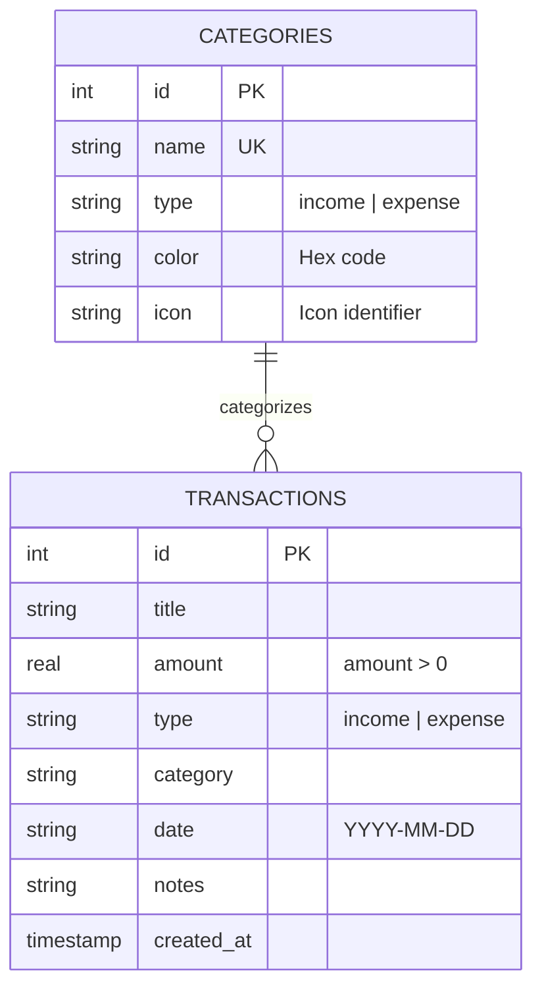
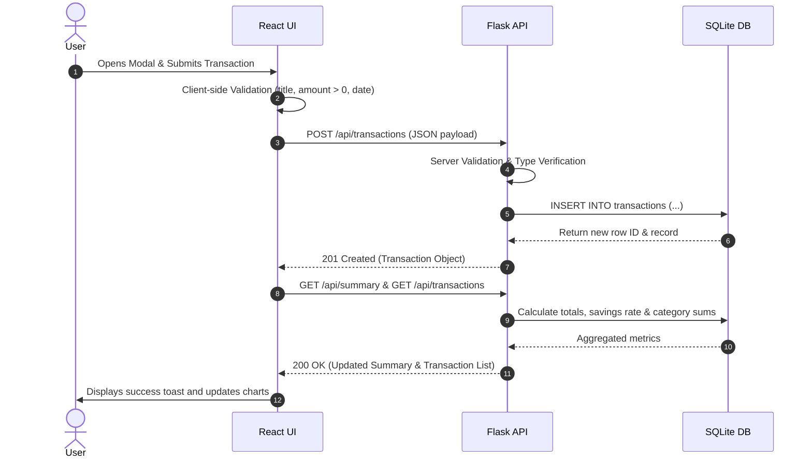

# 💰 ExpenseEase — Technical System Documentation

**Author / Maintainer:** Vedika Mande / AIRA Engineering Assistant  
**Target System:** ExpenseEase — Personal Expense Tracker  
**Document Status:** Complete & Active  
**Last Updated:** October 2026  

---

## 1. Executive Summary & Change Log

### 1.1 Overview of System Implementation
The ExpenseEase application has been designed, architected, and fully implemented according to the updated technology stack:

* **Frontend:** React 19 + JavaScript (Vite)
* **Backend:** Python + Flask REST API
* **Database:** SQLite (Embedded, zero-config relational store)
* **Version Control:** Git & GitHub
* **Containerization:** Docker & Docker Compose
* **CI/CD:** GitHub Actions Automation
* **Cloud Deployment:** Amazon Web Services (AWS EC2 / ECS / App Runner)

### 1.2 Key System Modifications
1. **Database Layer (SQLite):**
   * Configured `backend/database.py` with foreign key enforcement and row factory mappings.
   * Auto-initialization with schema tables (`transactions`, `categories`) and seeded default records.
2. **Backend API (Flask):**
   * Built `backend/app.py` providing endpoints for transactions CRUD, filtering, categorization, and financial metrics calculations.
   * Universal CORS compatibility and error handling.
   * Automated unit testing suite with 100% pass rate (`backend/tests/test_api.py`).
3. **Frontend Dashboard (React):**
   * Decoupled SPA structure under `frontend/src/` with dedicated components (`Header`, `StatCards`, `AnalyticsCharts`, `TransactionFilters`, `TransactionList`, `TransactionModal`, `NotificationToast`).
   * Visual charts for category expense distribution and monthly income/expense trends.
   * CSV export capability and real-time backend connection status monitoring.
4. **DevOps & Cloud:**
   * Multi-stage `Dockerfile` for frontend with Nginx reverse proxy.
   * Lightweight Python `Dockerfile` for backend using Gunicorn.
   * Orchestrated `docker-compose.yml` with named volume persistence for SQLite.
   * Automated GitHub Actions CI workflow in `.github/workflows/ci-cd.yml`.
   * AWS deployment artifacts and automation script in `aws/`.

---

## 2. System Architecture & Component Interactions



---

## 3. Database Architecture & Entity Relationship (ER) Diagram

### 3.1 Entity Relationship Diagram



### 3.2 Relational Schema Definitions (DDL)

#### Categories Table
```sql
CREATE TABLE IF NOT EXISTS categories (
    id INTEGER PRIMARY KEY AUTOINCREMENT,
    name TEXT UNIQUE NOT NULL,
    type TEXT CHECK(type IN ('income', 'expense')) NOT NULL,
    color TEXT NOT NULL,
    icon TEXT NOT NULL
);
```

#### Transactions Table
```sql
CREATE TABLE IF NOT EXISTS transactions (
    id INTEGER PRIMARY KEY AUTOINCREMENT,
    title TEXT NOT NULL,
    amount REAL NOT NULL CHECK(amount > 0),
    type TEXT CHECK(type IN ('income', 'expense')) NOT NULL,
    category TEXT NOT NULL,
    date TEXT NOT NULL,
    notes TEXT,
    created_at TIMESTAMP DEFAULT CURRENT_TIMESTAMP
);
```

---

## 4. Sequence & Logic Flow

### 4.1 Transaction Creation & Analytics Refresh Flow



---

## 5. REST API Specifications & Contracts

### 5.1 Endpoints Summary

| Method | Route | Parameters | Success Code | Description |
|---|---|---|---|---|
| `GET` | `/api/health` | None | `200 OK` | Verifies API health and SQLite database connectivity |
| `GET` | `/api/summary` | None | `200 OK` | Computes totals, balance, savings rate, and category breakdowns |
| `GET` | `/api/categories` | `type` (`income`/`expense`, optional) | `200 OK` | Retrieves available categories |
| `POST` | `/api/categories` | JSON body | `201 Created` | Creates a custom category |
| `GET` | `/api/transactions` | `type`, `category`, `search`, `start_date`, `end_date`, `sort_by`, `order` | `200 OK` | Lists filtered transactions |
| `POST` | `/api/transactions` | JSON body | `201 Created` | Inserts a new transaction |
| `GET` | `/api/transactions/<id>` | Path variable `id` | `200 OK` | Retrieves a single transaction |
| `PUT` | `/api/transactions/<id>` | Path variable `id`, JSON body | `200 OK` | Updates an existing transaction |
| `DELETE` | `/api/transactions/<id>` | Path variable `id` | `200 OK` | Removes transaction from database |

---

## 6. Testing & CI/CD Pipeline Logic

### 6.1 Backend Automated Tests (`backend/tests/test_api.py`)
* Isolated temporary SQLite database per test run (`tempfile.mkstemp()`).
* Verifies:
  1. Health check and database connectivity.
  2. Category listing and default seeding.
  3. Valid transaction creation, field retrieval, update, and deletion.
  4. Validation rejection for negative amounts and invalid transaction types.
  5. Accurate calculations of net balance, total income, and total expenses.

### 6.2 GitHub Actions Workflow (`.github/workflows/ci-cd.yml`)
* **Trigger:** Push or pull request to `main` branch.
* **Job 1 (Backend):** Python 3.11 environment, dependency resolution, unittest execution.
* **Job 2 (Frontend):** Node.js 20 environment, package installation, production Vite build.
* **Job 3 (Docker):** Builds backend and frontend images using Buildx.

---

## 7. Cloud Deployment (AWS) Strategy
* **Container Hosting:** Docker Compose on AWS EC2 or Amazon ECS Fargate.
* **Reverse Proxy:** Nginx routes incoming traffic on port 80:
  * Static web traffic `/` maps directly to pre-compiled React build.
  * API endpoints `/api/*` reverse proxy to Gunicorn WSGI running on port 5000.
* **Storage Persistence:** Named volume in Docker or Amazon EFS mount at `/app/data` to ensure zero data loss across container lifecycles.

